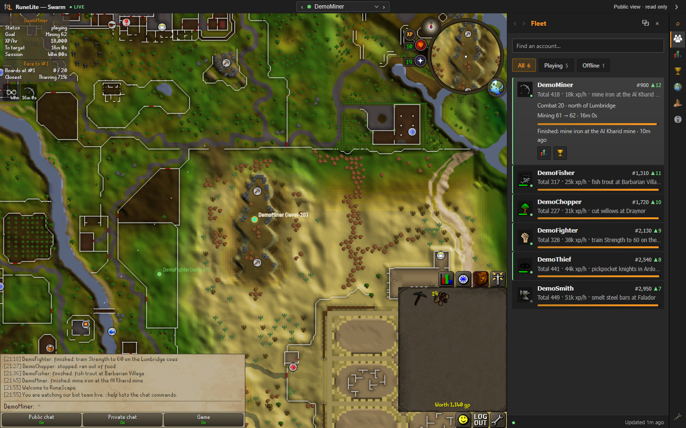

# rs-fleet-dashboard

[](https://github.com/Giftedx/rs-fleet-dashboard/actions/workflows/test.yml)

A dashboard for a team of [rs-sdk](https://github.com/MaxBittker/rs-sdk) bots, in the style of the RuneLite client. It is a static site: no build step, no framework and no server of its own. `site/` is the whole site.

The page shows:

- a live 3D view of the game world that follows one bot, or up to 16 bots at once
- a world map and a minimap with each bot as a dot
- the skills, the inventory, the worn items and the quests of each bot
- an XP tracker with XP for each hour and the time to the next level
- the hiscore ranks of each bot and the players above them
- game results, alerts and market prices in a plugin sidebar



**Live example:** [giftedx.github.io/rs-fleet-command](https://giftedx.github.io/rs-fleet-command/) shows a fleet of bots on the rs-sdk demo world.

This is an independent project. It is not the RuneLite client. It is not affiliated with RuneLite or with Jagex.

## Try it with demo data

You need [Bun](https://bun.sh).

```bash
bun install
```

```bash
bun run demo
```

Open `http://127.0.0.1:3200`. The command writes `demo/public.json` with six made-up bots and serves the page with it. The picture above is this demo. The 3D view stays empty until you install the game cache (below).

## Show your own bots

The page reads one file, `public.json`, from the folder that serves it. A program that writes this file is a publisher. `site/shim.js` loads before the page and answers each request of the page from that file.

### The ready publisher

`scripts/publish.ts` needs no access to your bots. It reads two public sources of the game server: the world feed, and the hiscore pages. Give it the names of your bots:

```bash
bun scripts/publish.ts --names Alice,Bob --out demo
```

In a second terminal, serve the page with that folder:

```bash
bun run serve --data demo
```

The publisher writes a new file each 60 seconds. It shows where each bot is, if it is online, its levels, its hiscore ranks and the top 10 of each board.

| Option | Meaning |
|---|---|
| `--names a,b` | The account names of your bots |
| `--server <host>` | The game server. The default is `rs-sdk-demo.fly.dev` |
| `--out <folder>` | Where to write `public.json`. The default is `demo` |
| `--every <seconds>` | The time between two files. The default is 60 |
| `--once` | Write one file and stop |

The public sources do not give inventories, worn items, quests, XP or goals. Those parts of the page stay empty.

### Your own publisher

A publisher that reads your bots can fill every part of the page.

- [docs/data-format.md](docs/data-format.md) describes each key of the file.
- [scripts/make-demo.ts](scripts/make-demo.ts) builds a full file in 100 lines. Start from it.

## The 3D view

`site/viewer/` is a build of the [rs-world fork](https://github.com/Giftedx/rs-world), which adds an embed API and camera flight to [MaxBittker/rs-world](https://github.com/MaxBittker/rs-world). Its multi-view is a port of work by Stunned ([TestingPurposes/rs-world](https://github.com/TestingPurposes/rs-world)). The view streams players from the world feed of the game server, so the server must run with `WORLD_FEED=true`.

The view needs the game cache. The cache is not in this repository.

1. Clone the rs-world fork.
2. In that folder, run `yarn sync-cache`. Its README gives the options for a local engine and for a remote server.
3. In this folder, run the command below.

```bash
bun scripts/install-cache.ts ../rs-world
```

## Settings

`site/config.js` holds the settings.

| Setting | Meaning |
|---|---|
| `server` | The game server. The 3D view streams `wss://<server>/worldfeed`. The Hiscores link opens `https://<server>/hiscores`. |
| `repo` | The GitHub repository (`owner/name`) for the owner sign-in. On `<owner>.github.io/<name>/` the page takes it from the address. If there is no repository, the page is public view only. |

After you change `config.js` or `shim.js`, run this command. It stamps each script link with a hash of its file, so a browser loads the new file.

```bash
bun scripts/apply-config.ts
```

## Names in the 3D view

- `site/api/our-names` is a JSON list of your bot names. The 3D view draws these names in gold.
- `site/api/hidden-names` is a JSON list of names that the 3D view must not show. An entry is a name, or `h:` and the FNV-1a hash of the lower-case name as 8 hex digits.

## Host it on GitHub Pages

Keep your data off the `main` branch. One command puts the page and your `public.json` on a branch named `site`:

```bash
bun scripts/deploy.ts --data demo
```

The branch holds one commit. Each run replaces it, so the branch keeps no history of your data. The command copies `public.json` and `map.bin` only. It never copies `control.json`.

1. Make your own repository from this one and clone it.
2. Start a publisher, so the folder has a fresh `public.json`.
3. Run the command above. Run it again when you want the hosted page to show new data, at most 6 times an hour. GitHub Pages builds at most 10 times an hour.
4. In the repository settings, set Pages to deploy from the branch `site`, folder `/ (root)`.

`--dry-run` builds the folder and pushes nothing. `--remote` and `--branch` name a different target.

## Owner sign-in and commands

The owner can sign in on the page with a fine-grained GitHub token for the repository. The token goes to the GitHub API only. Then the page does these things:

- It reads `control.json` from the branch `data` through the GitHub API. This file can hold data that the public file must not hold.
- It writes each command as `commands/<uuid>.json` on `main`. Your publisher reads the file, applies the command and writes a receipt into `control.json`.

The page accepts a token only when its user is the owner of the repository. Your publisher must check each command too: the committer, the age and the id. [docs/data-format.md](docs/data-format.md) gives the command format.

On `localhost`, `?control` shows the control view without a token. The page reads `control.json` beside the page and does not send commands.

## Keep private data out

`bun run check-private` fails when a tracked file is a data file (`public.json`, `control.json`, `map.bin`, `bot.env`) or holds a name from your private list. Put the names that must stay private in `.private-names`, one for each line. Git ignores that file. Run the check before each push.

## Commands

| Command | What it does |
|---|---|
| `bun run demo` | Writes demo data and serves the page at `http://127.0.0.1:3200` |
| `bun scripts/publish.ts --names a,b` | Writes `public.json` for your bots from the world feed and the hiscores |
| `bun scripts/deploy.ts --data <folder>` | Puts the page and `public.json` on the branch `site` for GitHub Pages |
| `bun run serve` | Serves `site/`. `--data <folder>` reads `public.json`, `control.json` and `map.bin` from that folder |
| `bun test` | Runs the tests |
| `bun run typecheck` | Checks the types of the scripts and tests |
| `bun run check-private` | Checks the tracked files for private data |

## Files

| File | What it is |
|---|---|
| `site/index.html`, `*-shell.*`, `operations.*`, `xp-tracker.js` | The page |
| `site/shim.js` | Answers the requests of the page from `public.json`. Holds the sign-in and the command files |
| `site/config.js` | The settings |
| `site/viewer/` | The 3D view |
| `site/client-assets/` | Interface art and fonts. `ATTRIBUTION.txt` gives the source of each file |
| `scripts/publish.ts` | The ready publisher: world feed and hiscores to `public.json` |
| `scripts/make-demo.ts` | Demo data, and the example of a publisher |
| `scripts/deploy.ts` | Puts the page and the public data on one branch for GitHub Pages |
| `scripts/import-page.ts` | Copies the page from the folder of a local dashboard server and makes its paths relative |
| `scripts/make-items-webp.py` | Writes `site/items.webp` from `site/items.png` and checks that the pixels match |

## License and credits

The code is under the BSD 2-Clause license ([LICENSE](LICENSE)).

- Multi-view and the ground items in the 3D view are ports of work by Stunned ([TestingPurposes/rs-world](https://github.com/TestingPurposes/rs-world), BSD 2-Clause). The touch gestures are by Kaden Staker ([kadeski](https://github.com/kadeski)).
- The 3D view is a build of rs-world, a fork of [rs-map-viewer](https://github.com/dennisdev/rs-map-viewer) by dennisdev (BSD 2-Clause, `site/client-assets/RS-WORLD-LICENSE.txt`).
- The sidebar icons and the colours come from [RuneLite](https://github.com/runelite/runelite) (BSD 2-Clause, `site/client-assets/RUNELITE-FULL-LICENSE.txt`).
- The game art and the fonts are the property of Jagex. The code license does not cover them. `site/client-assets/ATTRIBUTION.txt` lists each source.
